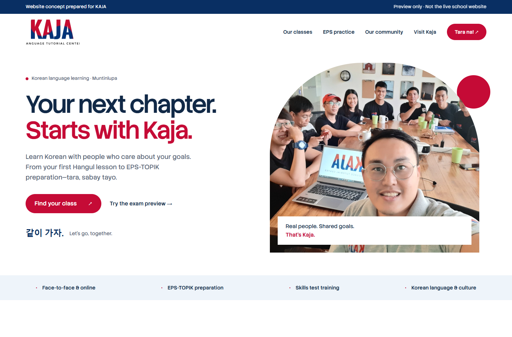

# Kaja website mockup

An independent landing-page proposal for Kaja Language Tutorial Center, prepared by Ron. This is a concept, not the school's live website or a complete exam platform.

[View the full-page preview](preview/full-page.png)

## Included

- Original Kaja logo and red/navy brand colors.
- School photographs and information from Kaja's existing public website.
- Responsive navigation and course-format tabs.
- One original Korean graph question with answer feedback and reset.
- Two automatically scrolling rows showing all 97 passers, without visible carousel controls or explanatory captions.
- Published student results, frequently asked questions, and existing enrollment/contact links.
- Keyboard controls, visible focus states, and reduced-motion support.

## Preview locally

Download the repository and open `index.html` in a browser. No installation or build is required. Google Fonts requires an internet connection; system fonts are used as a fallback.

The `preview` directory contains screenshots that can be viewed directly on GitHub.

## Scope and sources

Logo, photos, school details, and existing enrollment links came from https://kajalanguagecenter.com/ and its About, Services, Contact, and Gallery pages, reviewed on 28 October 2026. Course information must be confirmed with Kaja before a final launch.

The graph question is an original demonstration, not an official HRDK question. Proposed account access, listening exams, results, and student services are not implemented in this mockup. No personal information is collected by this page. Existing enrollment/contact links lead to external services.

This repository is separate from JCAN's production website. It contains no student accounts, API keys, authentication secrets, or hosting credentials. The preview includes `noindex,nofollow` metadata.
